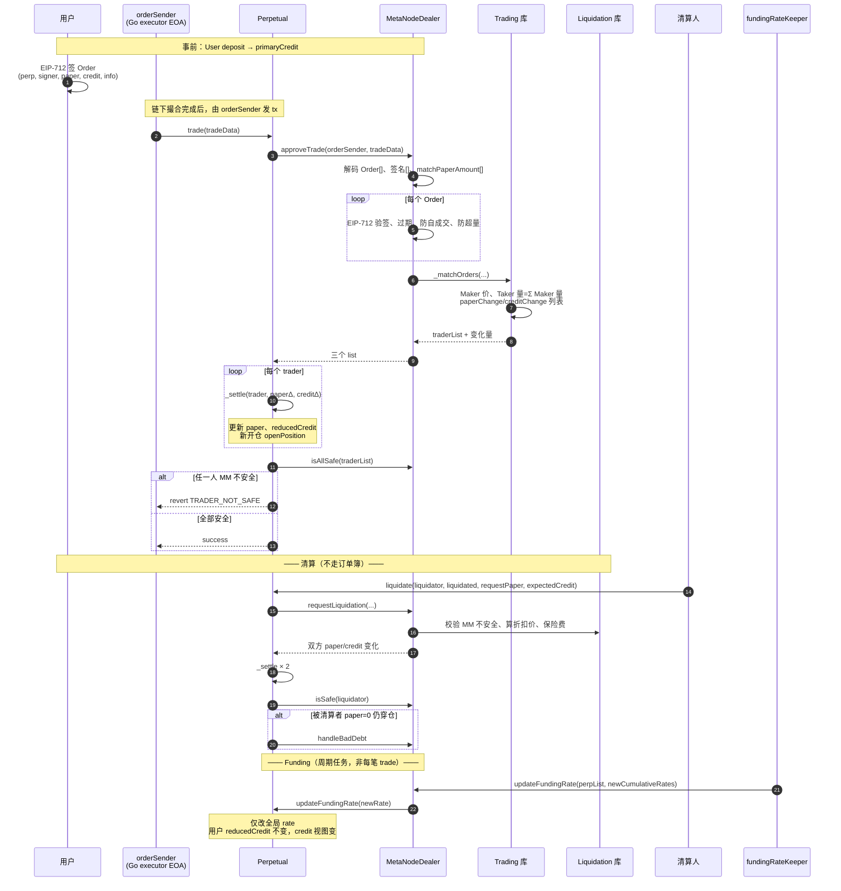
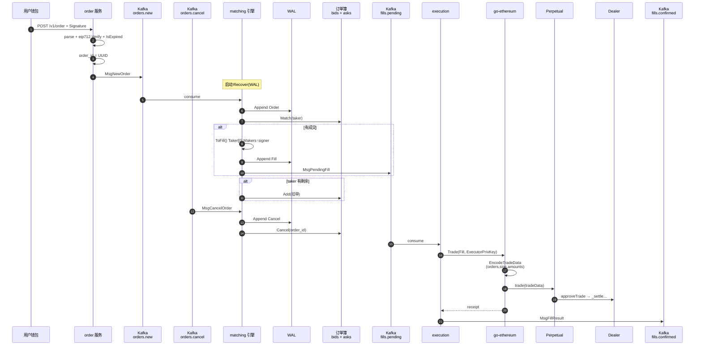

# 合约实操恢复计划 · MetaNode 永续（链上 + 后端）

> **阶段 3 主文档**：Day 16–21 永续深入；Kinza 见 [kinza-lending.md](/projects/kinza-lending)。  
> **代码路径**：`~/Desktop/personal/liyanyan/perpetual-new-contract` · `perpetual-go` ·（可选）`perp-backend`

---

## 进度（永续告一段落标准）

| 块 | 内容 | 状态 |
|----|------|------|
| 链上成交 | `trade` → `approveTrade` → `_matchOrders` → `_settle` | ⬜ 自测 |
| 链上 funding | 累计 `fundingRate`、`reducedCredit` 读 credit | ⬜ 自测 |
| 链上清算 | `getTotalExposure` / MM、`liquidate` | ⬜ 自测 |
| Go 后端 | `perpetual-go` 三服务 + Kafka + 上链 | ⬜ 自测 |
| 口播 | 30s 架构 + **2min 后端** + **2min 链上** | ⬜ 录音 |

---

## 一、业务定位（简历一句话）

- **背景**：CEX 级 **现货订单簿** 能力之上，扩展 **永续分支**（不是 DEX AMM，也不是「在 Uniswap 上加杠杆」）。
- **分工**：**链下**撮合多空 **Order（paper/credit）**；**链上** Dealer 管保证金与全仓风控，Perpetual 管单市场仓位账本。
- **与 Kinza**：Kinza 是 **另一家公司** 的 **DeFi 借贷（Aave V3 类）**，与永续交易 **不是一条产品线**。

---

## 二、链上合约总结（perpetual-new-contract）

### 2.1 核心角色

| 组件 | 职责 |
|------|------|
| **MetaNodeDealer** | `primaryCredit` 保证金；`deposit/withdraw`；`approveTrade` 验 EIP-712；全仓 **netValue vs MM**；`requestLiquidation`；`updateFundingRate`（keeper） |
| **Perpetual（每市场一个）** | `paper` + `reducedCredit`；全局 **fundingRate（累计）**；`trade` / `liquidate`；`_settle` |
| **Trading.sol** | `_matchOrders`：Taker+Maker、Maker 价、`paperChange`/`creditChange` |
| **Liquidation.sol** | `getTotalExposure`、`_isMMSafe`；清算折扣价、保险费 |

### 2.2 必背公式

**单市场读 credit（不单独存 full credit）：**

```text
credit = paper × fundingRate + reducedCredit
```

**`_settle`（每次 trade/liquidate 对每人执行）：**

```text
新 credit（中间量）= 旧 paper×rate + 旧 reducedCredit + creditChange
新 paper           = 旧 paper + paperChange
新 reducedCredit   = 新 credit − 新 paper×rate
paper → 0          → realizePnL → 写入 Dealer primaryCredit
```

**全仓安全：**

```text
单市场仓位价值 = paper×markPrice + credit（按 balanceOf 算 credit）
netValue = Σ 仓位价值 + primaryCredit + secondaryCredit
MM = Σ (|paper×mark| × liquidationThreshold)
安全 ⇔ netValue ≥ MM
```

**Funding：** 链下按 mark/指数算 **本期增量**，累加成新 **累计 fundingRate**；`fundingRateKeeper` 调 `updateFundingRate`；持仓侧 **Δcredit ≈ paper × Δrate**（未 `_settle` 时 `reducedCredit` 不变）。

**Order 方向：**

```text
做多：paperAmount > 0，creditAmount < 0
做空：paperAmount < 0，creditAmount > 0
限价 ≈ |credit| / |paper|
```

### 2.3 链上成交与清算时序图



### 2.4 链上 2 分钟口播稿

> 用户先把 USDC **deposit** 到 Dealer 当 **primaryCredit**，开仓不会再从钱包划一笔。交易用钱包 **EIP-712** 签 **Order**：**paper 正负表示多空**，**credit 与 paper 异号**，比值是限价。  
> 链下撮合好后，注册的 **orderSender** 调 **Perpetual.trade(tradeData)**。合约里 **Dealer.approveTrade** 验签、防自成交，**Trading._matchOrders** 按 **Maker 价** 算出每个人的 **paperChange、creditChange**。  
> **Perpetual._settle** 更新 **paper 和 reducedCredit**，保证 **credit = paper×fundingRate + reducedCredit**；最后 **isAllSafe** 检查全员 **netValue ≥ MM**。  
> **Funding** 由 keeper 把链下算好的 **累计 rate** 写进 Perpetual，不动每个用户 storage。  
> **清算** 在 **MM 不安全** 时走 **liquidate**，**固定折扣价** 强制转让，不走订单簿；穿仓 **handleBadDebt**。

### 2.5 链上阅读清单（入口）

| 顺序 | 文件 |
|------|------|
| 1 | `libraries/Trading.sol` → `_matchOrders` |
| 2 | `Perpetual.sol` → `trade` / `liquidate` / `_settle` / `updateFundingRate` |
| 3 | `libraries/Liquidation.sol` → `getTotalExposure` / `_isMMSafe` / `getLiquidateCreditAmount` |
| 4 | `MetaNodeExternal.sol` → `approveTrade` / `deposit` |

---

## 三、Go 后端总结（perpetual-go）

### 3.1 三服务 + Kafka

| 服务 | 职责 |
|------|------|
| **order** | `POST /v1/order`：验 EIP-712（Domain.verifyingContract = **Dealer**）→ `Info` 过期检查 → **UUID order_id** → **`perpetual.orders.new`** |
| **matching** | 消费 **orders.new / orders.cancel**；**WAL**；按 **perp** 维护 **bids+asks** 红黑树；产出 **`perpetual.fills.pending`** |
| **execution** | 消费 **fills.pending** → **`PerpClient.Trade`** → **`perpetual.fills.confirmed`** |

**默认 Topic（`config.example.yaml`）：**

```text
perpetual.orders.new
perpetual.orders.cancel
perpetual.fills.pending
perpetual.fills.confirmed
```

**本仓库三进程内未包含（生产常见扩展）：** FundingRateKeeper 定时任务、Liquidator、MySQL 落库、链上对账、监控。`pkg/chain` 已封装 `UpdateFundingRate` / `IsSafe`。

### 3.2 订单簿与链上一致性

- **每个 perp 一本 OrderBook**，内含 **bids（买，价高优先）** 与 **asks（卖，价低优先）**；同价 **FIFO**。
- **新进 Kafka 的订单 = Taker**；簿上 resting = **Maker**。
- **Taker 买** → 对手 **asks**；**Taker 卖** → 对手 **bids**。
- 撮合规则对齐 **Trading._priceMatchCheck**；成交价 **Maker 价**。
- **`ToFill()`**：`orderList[0]` = Taker；Makers 按 **signer 地址升序**；`matchPaperAmount[0]` = 各 maker 成交量之和。

**Info 字段（32 字节，非「订单类型」）：** `makerFeeRate | takerFeeRate | expiration | nonce`（见 `pkg/types/info.go`）。

**发链上 tx 的 `from`：** 配置 **ExecutorPrivKey**（须为链上 **validOrderSender**），**不是** 用户 Signer。

### 3.3 Go 后端时序图



### 3.4 Go 后端 2 分钟口播稿（面试主背）

> MetaNode 永续后端是 **三个 Go 服务 + Kafka**。用户 POST 订单，body 里是 **EIP-712 签好的 Order**：**perp、signer、paper、credit、info、signature**。order 服务用 **Dealer 地址做 Domain** 验签，检查 **info 里的 expiration**，生成 **UUID 作为 order_id**，写到 **`perpetual.orders.new`**。  
> matching 启动时 **Recover WAL**，然后消费 new 和 **orders.cancel**。每笔新单 **先写 WAL 再撮合**：每个 **perp** 一本簿，**bids 和 asks 两棵红黑树**，新进单是 **Taker**，和对手盘 **Maker** 按 **Maker 价** 成交，规则与链上 **Trading** 一致。成交后 **ToFill**：**Taker 在数组第 0 位**，多个 Maker 按 **signer 升序**，再发 **`perpetual.fills.pending`**；Taker 没吃完的 **挂回簿里**。  
> execution 消费 pending，在 **chain 包**里把 Fill **abi.encode 成 tradeData**，再 **pack Perpetual.trade**，用 **executor 私钥**（链上注册的 **orderSender**）发交易，**go-ethereum** 等 receipt，结果发到 **`fills.confirmed`**。  
> 链上同一笔 tx 里 **approveTrade 验签、_matchOrders、_settle、isAllSafe**。我 Web2 做过 **支付对账**，这里对应 **订单/成交与链上 tx 的闭环**。Funding keeper、DB、监控在 **perp-backend** 或运维侧扩展，**perpetual-go** 专注 **撮合到上链** 主路径。

### 3.5 Go 阅读清单（入口）

| 顺序 | 路径 |
|------|------|
| 1 | `services/order/handler.go` |
| 2 | `services/matching/engine.go` + `internal/orderbook/match.go` |
| 3 | `services/execution/gateway.go` |
| 4 | `pkg/chain/perpetual.go` + `pkg/types/order.go` + `info.go` |

**对照单体实现（30min）：** `perp-backend/metanode.go` + `internal/engine/matchengine.go`（无 Kafka，逻辑同源）。

---

## 四、链上 vs 后端对照

| 环节 | 链下（Go） | 链上（Solidity） |
|------|------------|------------------|
| 订单有效性 | HTTP 验签 + 过期 | `approveTrade` 再验签 + 超量/自成交 |
| 价格/成交量 | 红黑树撮合 | `_matchOrders` + `_priceMatchCheck` |
| 批次格式 | `types.Fill` → `EncodeTradeData` | `abi.decode(Order[],bytes[],uint256[])` |
| 发送者 | ExecutorPrivKey | `msg.sender` = orderSender |
| 账本 | 无（或扩展 DB） | `_settle` + Dealer 保证金 |
| 风控 | 可选 `IsSafe` 读链 | `isAllSafe` 强制 revert |

---

## 五、常见口误（自检）

| 误 | 正 |
|----|-----|
| order_id = 链上 orderHash | HTTP 用 **UUID**；链上用 **Order 结构 hash** 验签 |
| Info = 订单类型 | **费率 + expiration + nonce** |
| 发 tx 用用户私钥 | **executor / orderSender** |
| 永续在 DEX 池子里成交 | **订单簿 + Perpetual 仓位**，非 AMM |
| reducedCredit = 剩余保证金 | **单市场记账余项**；保证金在 **primaryCredit** |
| 每笔 trade 更新 funding | **keeper 周期 updateFundingRate** |

---

## 六、下一阶段

- [ ] Kinza：`GenericLogic` + `LiquidationLogic` + 必背 3 题  
- [ ] 对比表：MetaNode 清算 vs Kinza 清算  
- [ ] 简历：MetaNode（CEX 背景+永续）+ Kinza（借贷）+ Web2 支付对账  

---

*更新：2026-10-10 · 阶段 3 永续链上/后端串讲*
